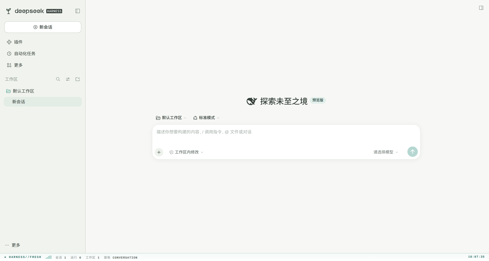
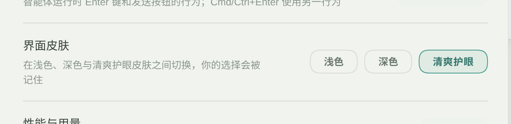

# dsh-dashboard · 清爽护眼皮肤与状态栏

[DSH (DeepSeek Harness)](https://www.npmjs.com/package/@deepseek-ai/dsh) Web 端的一套暖纸护眼皮肤，外加一条底部全局状态栏和侧栏的嫩芽标记。

皮肤不是「注册一个第三方主题」，而是用 `theme.overrideTokens` 打一层 token 覆盖：框架只持久化浅色/深色/跟随系统，第三方主题注册后重启就没了，覆盖层则由插件在每次激活时重新贴上去。所以切换过一次「清爽护眼」之后，刷新、重启都还在。

| 主界面：暖纸底色 + 底部状态栏 | 设置 → 通用 → 界面皮肤 |
|:---:|:---:|
|  |  |

## 功能

- **全局换肤**：约一百四十个 `--dsw-alias-*` / `--dsw-specific-*` / shiki token 整体换成暖纸配色，覆盖底色、边框、品牌色、状态色、按钮、滚动条、菜单、侧栏、输入框、气泡、Markdown 代码块、diff 与语法高亮，圆角也一并放大
- **底部状态栏**：26px 高的单行遥测条——`◈ HARNESS//FRESH` 品牌、跳动的均衡器、会话数、运行中会话数（>0 时变绿）、工作区数、当前中央面板、每秒刷新的时钟
- **侧栏嫩芽**：把侧栏左上角的品牌标记换成手绘嫩芽 SVG，尺寸跟随侧栏
- **三档切换**：设置 → 通用 → 界面皮肤里选 浅色 / 深色 / 清爽护眼，选择写进 `localStorage`，下次自动恢复
- **双语**：文案跟随 DSH 的语言设置（中文 / English）

## 环境要求

| 项 | 要求 |
| --- | --- |
| DSH | ≥ `0.2.1-rc.2`（需要 `shell.bottom`、`sidebar.brand.mark`、`settings.general.item` 三个槽位；`package.json` 里 `engines.dsh` 已声明） |
| 浏览器 | 桌面版 Chrome / Firefox / Safari 等现代浏览器（用了 `color-mix()` 与 `backdrop` 类 token） |
| 网络 | 只有安装时需要；运行时不发任何请求 |
| 构建 | 不需要。没有运行时依赖、没有构建步骤 |

## 安装

```bash
dsh plugin --profile web add github:Rustyibe/dsh-dashboard
# 然后重启 dsh web 并刷新页面
```

从 tarball 装：

```bash
npm pack                                        # 得到 local-dsh-dashboard-1.0.0.tgz
dsh plugin --profile web add ./local-dsh-dashboard-1.0.0.tgz
```

也可以在 DSH 的 Plugins 页面里填 `github:Rustyibe/dsh-dashboard` 安装。

验证：

```bash
dsh --profile web --dump-config | grep -A3 "id: dashboard"
```

装完刷新页面应该立刻看到暖纸底色和底部状态栏——**默认就是皮肤开启状态**。

## 使用

1. 想关掉皮肤：设置 → 通用 → 界面皮肤 → 选「浅色」或「深色」。皮肤层会被移除，同时把框架主题设成对应档位
2. 想换回来：同一行选「清爽护眼」
3. 选择记在 `localStorage` 的 `dsh-dashboard:skin`（`fresh` / `plain`），换浏览器或清缓存后会回到默认的「清爽护眼」

皮肤和框架的深浅色偏好是两件事：皮肤层不区分浅色/深色（两套都贴同一份暖纸值），选「浅色」「深色」时才会把层摘掉、露出框架原本的配色。

## 皮肤里改了什么

| 类别 | 例子 |
| --- | --- |
| 底色 | `--dsw-alias-bg-base: #f7f8f5`（暖白，不是纯白）、`bg-layer-1..3`、`bg-overlay`、文档预览与选区 |
| 文字 | `label-primary: #38423d`（软墨色，不用纯黑）、secondary / tertiary / caption / dimmed |
| 品牌色 | 鼠尾草青 `#4a9d8f`，连带 `button-primary-fill`、`link`、`interactive-bg-hover` 一整套 |
| 状态色 | 成功 / 警告 / 错误 / 空闲全部降饱和，避免刺眼 |
| 结构与控件 | 滚动条、菜单、tooltip、toast、侧栏、输入框、气泡、开关滑块 |
| 代码与 diff | Markdown 代码块、行内代码、diff 增删底色与标记、shiki 语法色 |
| 形状 | `--dsw-radius-xs..panel` 统一放大（6/10/14/18/22/28px）、焦点环改为品牌色 |

不想整体换、只想微调某一类：改 `client.js` 里的 `FRESH_TOKENS` 即可，键名就是框架的 token 名。

## 架构

```
index.js            Host 半边：空 apply（纯前端插件，不注册工具/路由）
client.js           全部逻辑：token 覆盖层、底部状态栏、皮肤切换行、嫩芽品牌标记
cordis.patch.yml    插入 dashboard 这一层（无 config）
locale/{zh,en}.json 插件管理页里的标题与描述
icon.svg            插件管理页图标（侧栏标记是 client.js 里的内联 SVG）
assets/             截图
```

占用的槽位：

| 槽位 | 优先级 | 内容 |
| --- | --- | --- |
| `shell.bottom` | `-10` | 全局状态栏（单值槽，负优先级盖过默认实现） |
| `sidebar.brand.mark` | `-10` | 嫩芽 SVG，`size` 由侧栏传入 |
| `settings.general.item` | `order: 30` | 「界面皮肤」三档切换行 |

数据链路：

1. 激活时读 `localStorage.dsh-dashboard:skin`，是 `fresh` 就调用 `ctx.theme.overrideTokens('@local/dsh-dashboard/fresh', FRESH_LAYER)` 贴层，并登记一个 effect 在卸载时把层摘掉
2. `FRESH_LAYER` 是 `{ token: { light, dark } }` 的形状——框架要求两种模式都给值，这里两套填同一个值，于是皮肤在浅色/深色偏好下都保持暖纸感
3. 状态栏订阅 `ctx.sessions.list` 与 `ctx.workspaces.list` 的快照：会话数只算 `updatedAt` 非零的行（subagent 目录项是 0，被排除），运行数是 `running` 为真的行数，面板 id 来自 `layout.panelInfo`
4. 时钟用 1 秒定时器，卸载时清掉；样式全部走 `--dsw-alias-*` 变量，所以换肤后状态栏自己也会跟着变色
5. 切换行调用 `onSkin()`：存 `localStorage` → 贴层或摘层 → 摘层时用 `ctx.theme.setTheme()` 写入框架偏好

## 安全与隐私

- **Host 半边是空的**：不注册模型工具、不开 HTTP 路由、不读写文件
- **不发请求**：运行时不访问任何网络服务
- **只写一个键**：`localStorage` 里的 `dsh-dashboard:skin`，除此之外不落盘、不写 cookie
- **不碰业务数据**：只读会话与工作区的计数、`running` 标志和当前面板 id，不看消息内容
- **可干净卸载**：token 覆盖层登记在 effect 里，插件卸载或停用后自动还原成框架配色

## 已知限制

- **皮肤不区分浅色/深色**：两套模式都是同一份暖纸值；想要真正的深色界面，去切换行选「深色」（会摘掉皮肤）
- **三档里没有「跟随系统」**：选「浅色」或「深色」会把框架偏好写成固定值；要恢复跟随系统，得去「外观」那一行改
- **只覆盖已知 token**：框架后续新增的 `--dsw-*` 变量不在表里时，会沿用默认配色，可能出现个别控件「不是暖纸色」
- **品牌文字硬编码**：状态栏的 `◈ HARNESS//FRESH` 不随语言切换
- **状态栏固定 26px**：内容单行不换行，窗口很窄时中段会被裁掉
- **面板 id 直接显示**：状态栏里的 `CONVERSATION` 之类是槽位 id 大写后的结果，不是本地化名称
- **仅 web 平台**：这些槽位只存在于 web 客户端

## 常见问题

| 现象 | 处理 |
| --- | --- |
| 刷新后皮肤没了 | 看设置里是不是被切到了「浅色/深色」；`localStorage['dsh-dashboard:skin']` 为 `plain` 时不会贴层 |
| 底部没有状态栏 | 确认已重启 `dsh web`；`shell.bottom` 槽旧版本没有，检查 DSH 版本 |
| 侧栏图标还是原来的 | 别的插件用了更低的 `priority` 抢同一个单值槽；`primary` 低者胜，改自己的 `priority` 即可 |
| 个别控件颜色不对 | 上游新增了未覆盖的 token，往 `FRESH_TOKENS` 里补一条 |
| 想要更冷的白/更暖的白 | 改 `--dsw-alias-bg-base` 与 `bg-layer-1..3` 四个值就够了 |
| 状态栏想换成别的内容 | 改 `GlobalStatusBar` 的字段，或整段删掉对应的槽位注册 |
| 状态栏挡住底部内容 | 它是 `shell.bottom` 的正常占位（26px），不是浮层；嫌高就在 `SKIN_CSS` 里改 `height` |

## 更新与卸载

```bash
# 更新
dsh plugin --profile web remove @local/dsh-dashboard
dsh plugin --profile web add github:Rustyibe/dsh-dashboard

# 锁到某个 tag
dsh plugin --profile web add github:Rustyibe/dsh-dashboard#v1.0.0

# 卸载
dsh plugin --profile web remove @local/dsh-dashboard
```

卸载后皮肤层随插件一起撤销，界面回到你原本的主题；`localStorage` 里的选择会留着，重装后仍是上次那档。想清零就执行 `localStorage.removeItem('dsh-dashboard:skin')`。

改完都要重启 `dsh web`。本地 `link:` 安装则只改代码、刷新页面即可（客户端 bundle 按文件 mtime 取新 rev）。

## 二次开发

| 想改什么 | 改哪里 |
| --- | --- |
| 整套配色 | `client.js` 里的 `FRESH_TOKENS` |
| 圆角、焦点环 | `FRESH_TOKENS` 末尾的 `--dsw-radius-*` 与 `--dsw-focus-ring-color` |
| 状态栏内容与样式 | `GlobalStatusBar` 与 `SKIN_CSS` 里的 `.dsh-bar*` |
| 状态栏高度 | `SKIN_CSS` 的 `.dsh-bar{height:26px}` |
| 侧栏图标 | `FreshBrandMark` 的 SVG 路径 |
| 皮肤在语言里的名字 | `locale/{zh,en}.json` 与 `client.js` 内的 `zh` / `en` 字典（两处要一致） |
| 切换行的位置 | `settings.general.item` 注册里的 `order: 30` |

## 开发与测试

```bash
node --check client.js          # 无构建，语法检查就够
npm pack --dry-run              # 看打包内容
```

临时实例（独立 `DSH_HOME`，不碰正在跑的那个）：

```bash
DSH_HOME=/tmp/dsh-dash-dev dsh plugin --profile web add "$PWD"
DSH_HOME=/tmp/dsh-dash-dev dsh --profile web --port 7788
```

皮肤状态存在浏览器里，调样式时想回到默认值：

```js
localStorage.removeItem('dsh-dashboard:skin')   // 刷新后重新贴层
```

改 `client.js` 之后刷新页面即可；如果页面报 `slot entry crashed`，先看控制台里那个槽位的组件收到了哪些 props——单值槽不会自动注入服务，需要在注册时用 `inject` 显式传入。

## License

[MIT](LICENSE) © 2026 Rustyibe —— 可自由使用、修改、再分发，保留版权声明即可。
